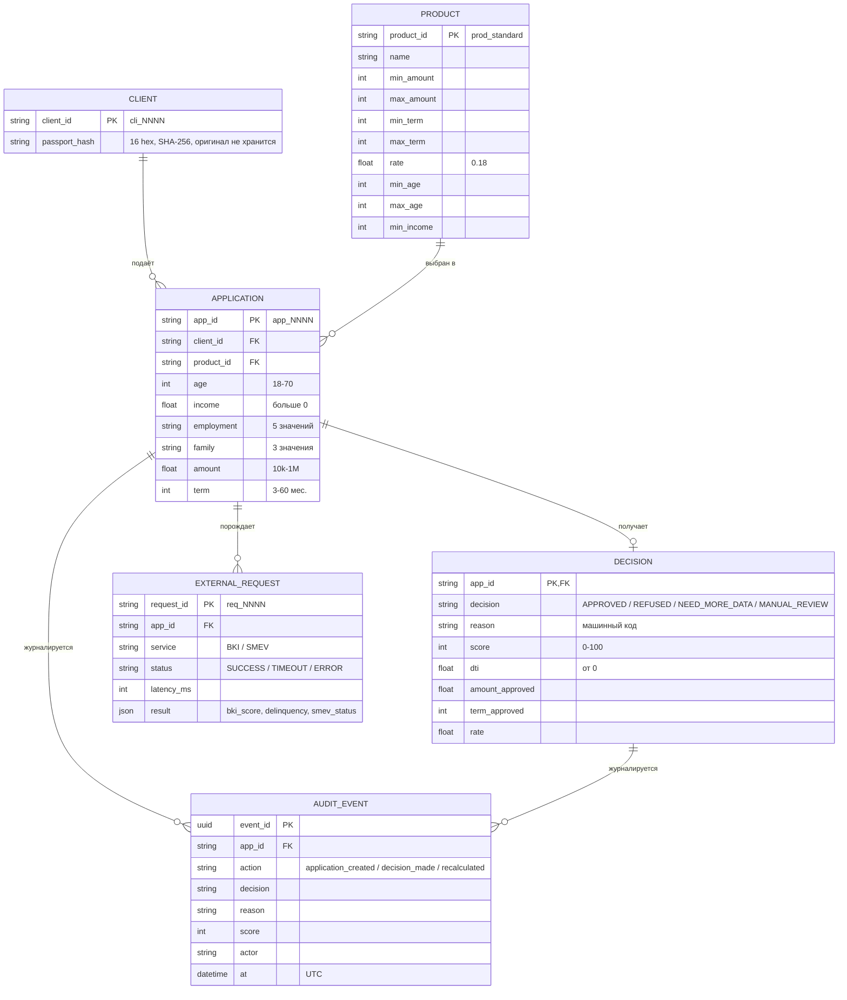

# Модель данных — кейс 2 «Кредитный конвейер»

Сущности: **Клиент**, **Заявка**, **Решение**, **Кредитный продукт**. Дополнительно — **Внешний запрос** (БКИ/СМЭВ) и **Событие аудита**, они нужны для интеграции и ИБ.

## ER-диаграмма

## Описание сущностей и связей

|Сущность|Назначение|Ключ|Связи|
|-|-|-|-|
|Client|Заёмщик. Хранится только хэш паспорта|client_id|1 клиент — много заявок|
|Application|Кредитная заявка: данные анкеты и параметры запроса|app_id|N:1 к Client, N:1 к Product|
|Decision|Предварительное решение по заявке|app_id|1:1 с Application (после расчёта; до этого 425)|
|Product|Условия продукта: суммы, сроки, ставка, возраст, минимальный доход|product_id|1 продукт — много заявок|
|ExternalRequest|Обращение к БКИ/СМЭВ: статус, время, результат|request_id|N:1 к Application, обычно 2 на заявку|
|AuditEvent|Неизменяемая запись о действии (append-only)|event_id|N:1 к Application|

## Соответствие файлам кейса

* Поля Application, Decision, ExternalRequest — `05_api_schemas.yaml`.
* Поля `applications.csv` (14 колонок) — `data_dictionary_sdel.md`; в CSV client_id, passport_hash и результаты БКИ/СМЭВ лежат в одной строке с заявкой для простоты прототипа.
* Продукты — `products.xlsx`; в версии кейса работает один продукт `prod_standard`, остальные (premium, student, pension, express) заведены в справочник как задел.
* Аудит — `ИБ.md`, п. 3.

## Ограничения модели

* Оригиналы паспортов и номера карт не хранятся (ИБ.md, п. 4).
* `reason` — машинный код из каталога `08_reasons_sdel.md`; текст клиенту берётся из каталога, а не хранится в решении.
* Поля пола и национальности в модели отсутствуют намеренно (NFR-05).
